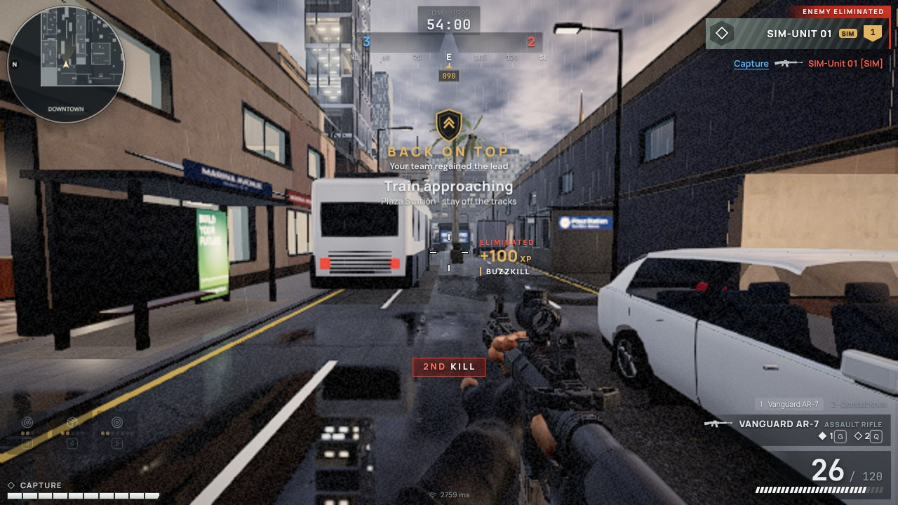
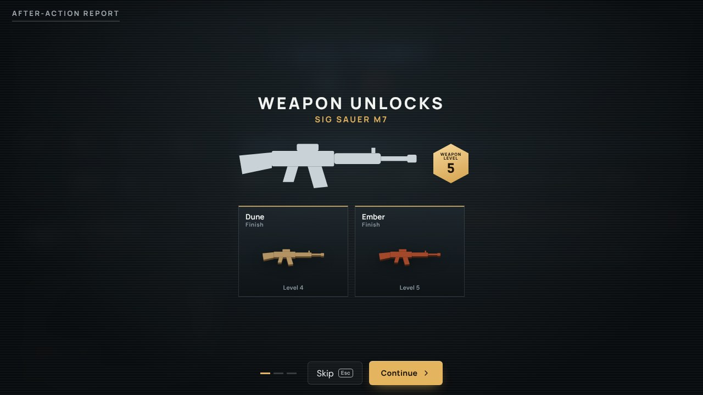

# Cinematic presentation: Operation: Metropolis

This update brings Operation: Metropolis closer to three reference clips supplied by the product owner: an end-of-match
**weapon unlocks** screen, an **elimination** with its experience, medals and kill count, and a **"back on top"** lead
change. They are references for feel and genre conventions only. Every name, layout, icon, colour and animation here
was made for this game in the arena's existing visual language. No art, interface, audio or text was taken from the
referenced game.

**Scope: Operation: Metropolis only.** The owner asked for the reference look on Metropolis alone, so the rendering
finish, the HUD styling and the new feedback all switch on from one place, `src/arena/look.ts` (`CINEMATIC_MAPS`).
Foundry Yard and Sim Quad keep their own look and the plain banners exactly as before. Enabling another map is one
entry in that set.

## What the player sees

### In a match (Metropolis)

| Moment | What appears | Decided by |
|---|---|---|
| You eliminate someone | Their **card** above the kill feed: their emblem on a plate in the emblem's colour, name, level, "Enemy eliminated" (with a headshot mark) | Server (`elim` event) |
| | **Experience** beside the crosshair (`+100 XP`, `+125` for a headshot), with the **medals** that came with it listed under it; an assist, capture or neutralisation arriving within 1.8 s adds to the same popup | Server |
| | **Eliminations this life** under the crosshair from the second one: `2ND KILL`, `3RD KILL` … | Server (`n`, the streak) |
| Your team goes ahead | **Taken the lead** under a crest, with a radio line | Server (`lead` event) |
| The enemy goes ahead | **Lead lost** | Server |
| Your team retakes a lead it had lost | **Back on top**: "Your team regained the lead" | Server (`back: true`) |
| A weapon reaches a new level, or you reach a new level | An **unlock notice**: "Cobalt finish unlocked · SIG Sauer M7 · weapon level 8", or "Level 5 · Unlocked: Hardline" | Client projection, confirmed by the database (below) |

New medals, awarded on every map: **Wallbang** (eliminated through thin cover), **Point Blank** (a gun from under
2.5 m), **Buzzkill** (ending an enemy's run of three or more). The existing medals (Headshot, First Blood, Double and
Triple Elimination, Revenge, Longshot, Payback, Defender, Five in a Row, Unstoppable) now come with the elimination
they belong to, in one `elim` event, instead of as separate messages. On other maps the client turns that event into
the same banners as before.

### After a recorded match (Metropolis): the after-action report

When the database has saved the result (`progress`), a report plays over the results before they are shown:

1. **Weapon unlocks**, one page per weapon that reached a new weapon level: its silhouette materialises, the new level
   appears on a badge, then a scan sweeps the card row and each finish unlocked between the old and new level is
   revealed (name, "Finish", the level, and the weapon in that finish's colours).
2. **Level up**, if the player level rose: the new level and a card for everything it unlocked (weapons, lethal and
   tactical equipment, perks, scorestreaks, emblems).

Each page moves on by itself after it has had time to be read; click, Space or Enter continues, Escape or **Skip**
closes the report. Every card is something the account really has: the pages come only from the database's reply,
never from the client's own count. Guests, Training and private matches are not recorded, so they have no report (the
results screen says why, as before).

### Weapon finishes: one at every weapon level

So that every weapon level-up has something to unlock, levels 2, 4, 6, 8 and 9 gained a finish (the five existing ones
are unchanged):

| Weapon level | 1 | 2 | 3 | 4 | 5 | 6 | 7 | 8 | 9 | 10 |
|---|---|---|---|---|---|---|---|---|---|---|
| Finish | Standard | **Slate** | Tidewater | **Dune** | Ember | **Fieldcraft** | Verdigris | **Cobalt** | **Arctic** | Gilded |

They are catalogue entries (`SKINS`, `shared/arena/weapons.mjs`) mirrored in the database by
`supabase/migrations/20261115120000_arena_weapon_finishes.sql`. `save_arena_loadout` and the arena server already check
any finish against the weapon's level, and `record_arena_match` already leaves finishes out of player-level unlocks,
so nothing else in the database changed. Finishes are cosmetic tints over the weapon's photographed materials, on
every map.

A fix that came with this: weapon levels reached in a match now apply at once. Before, the arena server kept the
weapon levels it read when the player opened the arena, so a finish unlocked in a match could not be equipped until
the arena was reopened. The server now updates the connection's weapon levels from the database's reply, and the
client updates its own, so the loadout editor offers the new finish straight away.

### Unlock notices during a match

Experience and weapon levels are recorded by the database when the match ends. To show an unlock at the moment it is
reached, the client adds what the server tells it (each `elim` with its weapon and headshot, assists, captures,
neutralisations, defends) to the account's totals from the `ready` message (`xp`, and the new `weaponXp`), and
announces a level crossed. It only does so where the match **will** be recorded by the server's own rule: Quick Play,
signed in, two or more people, after the first minute (notices reached earlier wait for it). The after-action report
is authoritative; the notice is a preview of it. The few things the projection does not count (the end-of-match
bonus, objective play the server does not report per player) can only make it announce later, never wrongly early.

## Rendering: the cinematic finish (Metropolis, Medium and above)

Each Metropolis weather keeps its own sky, light, haze and grade (`scene/city/atmosphere.ts`); the finish sits on top
of it (`src/arena/scene/cinematic.ts`), so Storm Break stays a storm and Blue Hour stays night. The values were set by
measuring frames of the reference clips against captures of the same kind of view (luminance mean, median and spread,
mean saturation; central region, HUD excluded): the references' daylight sits brighter than Metropolis's streets did
(mean about 0.45 against 0.30) with a similar spread and slightly less colour, and their interior is far darker than
Metropolis's shops were (about 0.14 against 0.43).

| | Before (weather's own grade) | Cinematic finish |
|---|---|---|
| Exposure | weather's base | × 1.3 |

| Saturation | 0.82–0.98 | × 0.9 (muted, filmic palette) |
| Contrast (power curve about mid-grey) | 1.06–1.10 | + 0.10 |
| Shade / light tint | weather's lift and gain | shade a little cooler, light a little warmer |
| Vignette | 0.32 at 0.30 | 0.46 at 0.22 |
| Film grain | 0.010 | 0.018 (fine, luminance-weighted, animated) |
| Bloom | weather's intensity | × 1.15 |
| Sharpening | none | contrast-adaptive sharpening after SMAA (`SharpenEffect`, `scene/grade.ts`) |
| Indoor exposure | × 1.45 indoors (the eye adapts up), × 1.35 underground | × 0.62 indoors, × 1.15 in the station: every shop gets the sky's light, so rooms are exposed down and read dim against bright windows and doors |

The sharpening pass is one extra full-screen pass on Medium, High and Ultra. Low has no post-processing on any map
(phones), so on Low only the exposure changes (brighter daylight, dim interiors).

## HUD (Metropolis)

* **Round tactical map**, centred on the player and turning with their view (their heading is always up), 42 m to the
  rim, north marked on the rim, a soft view cone, and the district name. The base map is drawn once at 3 px a metre
  and turned and scaled each frame (about 30 times a second). Other maps keep the north-up square map.
* **Lighter panels** behind the score, kill feed and weapon, so the city shows through.
* **Sniper scope**: the surround is the world blurred and darkened (a CSS backdrop filter) with a lit rim on the lens,
  instead of flat black.

All of it lives in the existing HUD slots, so HUD customisation still applies: the elimination card moves with the kill
feed, the lead call and unlock notices with **Kill notifications**, and hiding Kill notifications also hides the
experience popup and the count beside the crosshair (which, like the crosshair, stay centred and follow the HUD text
size).

## Files

| File | What |
|---|---|
| `server/arena/match.mjs` | Lead tracking (`checkLead`), `elim` summary event, Wallbang / Point Blank / Buzzkill, who neutralised a zone |
| `server/arena/service.mjs` | `weaponXp` in `ready`; weapon levels and XP refreshed after a recorded match |
| `shared/arena/rules.mjs`, `weapons.mjs` | Medal names and descriptions; five finishes; `skinsAt`, `skinsBetween` |
| `supabase/migrations/20261115120000_arena_weapon_finishes.sql` | The five finishes in `arena_catalog` |
| `src/arena/look.ts` | Which maps are cinematic (Metropolis) |
| `src/arena/store.ts` (`useFeedback`), `net.ts`, `hudViews.tsx`, `Hud.tsx`, `arena.css` | Feedback state, events, views and styles; round map |
| `src/arena/AfterAction.tsx`, `unlocks.ts`, `Results.tsx` | After-action report |
| `src/arena/scene/cinematic.ts`, `scene/grade.ts`, `Scene.tsx`, `scene/city/atmosphere.ts` | Cinematic finish, sharpening, indoor exposure |
| `tests/arena-feedback.test.mjs` | Server-side feedback and the finish track |
| `scripts/qa/arena-cinematic-shots.mjs` | Browser captures with real eliminations |

## Tests and captures

* `tests/arena-feedback.test.mjs` (4 tests) drives a real match with the shared simulation: shots are commands, hits are
  the server's ray casts. Lead taken, a level score that is not a change, lead taken by the other team, and **back on
  top**, heard identically by both sides and written to the combat log; one `elim` per elimination with experience,
  medals and the count this life, sent only to the shooter; Point Blank, Buzzkill and a real **Wallbang** through the
  sandbag line on Foundry Yard; one finish at every weapon level.
* The existing arena suites, including the database tests against a real PostgreSQL (the catalogue mirror now includes
  the five finishes), pass unchanged.
* `scripts/qa/arena-cinematic-shots.mjs` opens Training on Metropolis in Chromium, eliminates a unit through the server
  with real mouse input, and photographs the card, popup, count and each lead call; it stages an unlock notice and a
  saved result to photograph the after-action report (also at 844 × 390, checked for horizontal scrolling).
* Before/after: `LABEL=look-before|look-after QUALITIES=high VARIANTS=storm,day VIEWS=street,rooftop,interior,station
  SCALE=.5 node scripts/qa/metropolis-shots.mjs`; the comparison sheets are in `screenshots/arena/cinematic/`.

Rendering here is Chromium's software WebGL (SwiftShader, no GPU): the pictures are exact, frame rates are not
representative and no GPU or phone measurements were possible.

## Not done

* **Weapon attachments.** The reference unlock screen shows optics and grips. The arena has no attachment system:
  adding one means changes to the shared simulation, loadouts and the database, and attachment models that this build
  environment cannot fetch. Weapon levels unlock finishes instead.
* **Downed state and revives.** The arena's modes eliminate outright; there is no down-and-revive rule.
* **New announcer recordings.** The lead calls reuse the radio lines the game already has ("Good work, soldier" for a
  lead taken or regained, "We're losing ground" for a lead lost). There is no spoken "back on top".
* **Ammunition pickups** from eliminated players (shown in one clip) are not part of this update.
